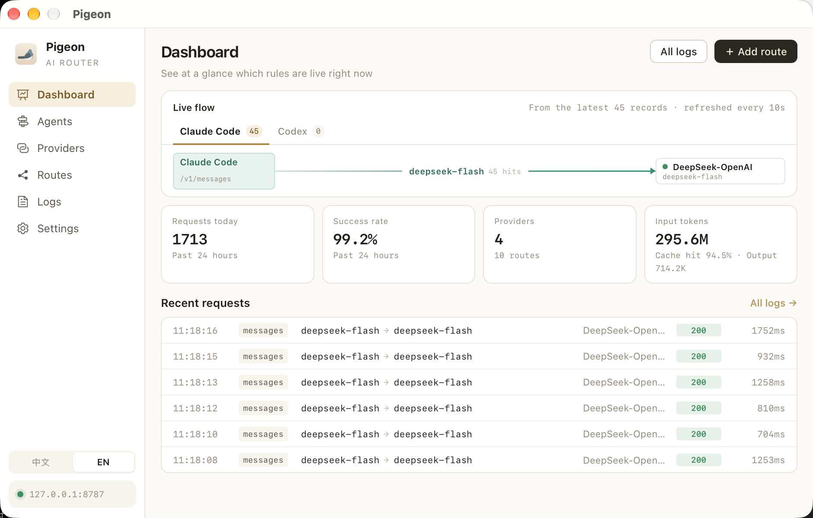

<div align="center">


# Pigeon

### Every agent's own protocol. Any model behind it.

**Claude Code on DeepSeek. Codex on Kimi. OpenAI-compatible clients straight through.**<br>
One gateway on your machine forwards them all; edit the routing table once and all three follow.<br>
Close the window and it slips into the tray, logs and usage still there.

[](https://github.com/charles6078/pigeon/releases/latest) [](https://github.com/charles6078/pigeon/releases)

[](https://github.com/charles6078/pigeon/releases) [](https://tauri.app) [](https://www.rust-lang.org) [](https://vuejs.org)<br>
    [](LICENSE)

**English** · [简体中文](README.zh-CN.md)

</div>

<br>

<div align="center">

</div>

<br>

## Is Pigeon for you?

Every agent keeps its model in its own file, with its own format, fields and base URL. One API key that you want in three agents has to be configured three times. Pigeon folds all of that into one local gateway and one desktop panel:

- **One model name, any upstream.** Point `claude-*` at `deepseek/deepseek-v4-pro` in the routing table and Claude Code's next request goes to DeepSeek — no agent config touched.
- **One machine's keys, shared by every agent.** Claude Code, Codex and OpenCode / Cline / Cherry Studio all connect to `127.0.0.1:8787`; change a provider in one place.
- **Mismatched protocols still work.** Anthropic Messages and OpenAI Responses come in, get translated to OpenAI Chat for the upstream, and streaming and tool calls are preserved.
- **API keys only, no subscription accounts.** No OAuth, no account pool, no quota scheduling — so no risk of an account getting flagged.
- **Observable on your machine.** Every request's models, upstream, status, latency, time to first token and input/output tokens (cache hits included) are in the log.

If you use one agent on its vendor's own plan and that's enough, you don't need it. It pays off when you have **several agents, several providers, or want one agent to use another vendor's model**.

## Quick start

**1 · Install.** Download the latest `.dmg` from [Releases](https://github.com/charles6078/pigeon/releases/latest) and drag Pigeon into Applications. The build is ad-hoc signed and not notarised, so on first launch macOS blocks it — right-click the app and choose **Open**, or run:

```sh
xattr -d com.apple.quarantine /Applications/Pigeon.app
```

Service only, no window:

```sh
/Applications/Pigeon.app/Contents/MacOS/pigeon --headless
```

It listens on `127.0.0.1:8787` by default.

**2 · Add a provider.** Open **Providers → Add**, pick a preset, paste a key, then click **Test connection** to confirm it's reachable.

**3 · Write a route.** On the **Routes** page, point a front-end model name at an upstream, for example `claude-opus-5-5 → anthropic/claude-opus-5-5` or `claude-* → deepseek/deepseek-v4-pro`. Rules are matched top to bottom; the first hit wins. Give the same pattern more than one rule and they form a fallback chain — if an upstream is unreachable or returns 401 / 403 / 404 / 429 / 5xx, Pigeon tries the next one in order. Each chain is one card, and **＋ Add fallback** at its foot appends another candidate.

**4 · Wire up an agent.** On the **Agents** page (接入) choose Claude Code / Codex / OpenCode and Pigeon writes the config into that agent's own file. It backs up the original first, and one click restores it.

Or configure by hand:

```sh
# Claude Code
export ANTHROPIC_BASE_URL=http://127.0.0.1:8787
export ANTHROPIC_AUTH_TOKEN=pigeon      # any value works when the access token is empty

# OpenAI-compatible clients
export OPENAI_BASE_URL=http://127.0.0.1:8787/v1
export OPENAI_API_KEY=pigeon
```

## Supported agents

| Agent | Front protocol | How |
| --- | --- | --- |
| **Claude Code** | Anthropic Messages | Point `ANTHROPIC_BASE_URL` here; works with Anthropic or any OpenAI Chat upstream |
| **Codex** | OpenAI Responses | In `~/.codex/config.toml`, set `base_url` and `wire_api = "responses"` |
| **OpenCode** | OpenAI Chat | The Agents page generates the `/v1` snippet and writes it for you |
| **Cline / Cherry Studio / other OpenAI-compatible clients** | OpenAI Chat | Base URL `http://127.0.0.1:8787/v1` |
| **Anything that takes a base URL** | OpenAI Chat | Same as above; model names are rewritten by the routing table |

## How it fits together

```
Claude Code ─┐
Codex ───────┤   127.0.0.1:8787                 ┌─ Anthropic
OpenCode ────┼──▶ route match ──▶ passthrough ──┼─ OpenAI / DeepSeek / Kimi
Cline ───────┘         │        or translate    ├─ GLM / Qwen / SiliconFlow
                       └── log · usage · stream └─ OpenRouter / Gemini / custom
```

The gateway speaks OpenAI Chat, Anthropic Messages and OpenAI Responses, and translates between them when needed — streaming, tool calls, images and errors are all rebuilt in the target protocol.

## What it does

### Any model, any agent

The routing table expresses routes as `pattern → provider/model`, with exact names and `*` wildcards and a live hit tester.

Reusing a pattern adds fallbacks: `deepseek-flash` can try DeepSeek first, then WorkBuddy, then Tencent — in the order you list them. A candidate is skipped when it is unreachable or answers 401 / 403 / 404 / 429 / 5xx; 400 / 413 / 422 stop the chain because the request itself is bad.

The Routes page groups rules by pattern into one card per chain and shows what each candidate actually did over the recent request log — share of the chain, success rate, average latency:

| Column | Meaning |
| --- | --- |
| Share | requests served by this candidate ÷ requests matched by the chain |
| Success | 2xx ÷ requests served by this candidate |
| Avg time | mean end-to-end duration |

`GET /v1/models` exposes the non-wildcard routes so clients like OpenCode can pull them.

### Protocol translation (the core)

| Front (what the agent speaks) | Upstream wire | Handling |
| --- | --- | --- |
| Chat Completions | `openai-chat` | **Byte passthrough** (SSE included) |
| Anthropic Messages | `anthropic` | **Byte passthrough** |
| Anthropic Messages | `openai-chat` | **Translate**: request, stream events, tool calls, images, errors |
| OpenAI Responses | `openai-chat` | **Translate**: request, event stream, `function_call`, errors |
| OpenAI Responses | Responses upstream | Passthrough |

The principle is **same protocol is never parsed**: the request body is streamed in and the response is written back chunk by chunk, passing through only the status code and necessary headers. Only cross-protocol requests parse JSON / SSE. The SSE parser buffers partial events, so any TCP split works. Failures before the first byte can be retried; after the first byte they are never retried, and errors travel as in-stream events.

### Providers

Presets cover **DeepSeek · Kimi · Zhipu GLM · OpenAI · Anthropic · Qwen (DashScope) · SiliconFlow · OpenRouter · Gemini · WorkBuddy · Custom**. Each provider can list several models, be edited at any time, and be **tested in one click** (status code and latency). Every upstream uses API keys only.

### Agents page: write it in, take it back out

No copying config by hand: pick an agent and Pigeon writes the `base_url`, token and current route models into its own file (`~/.claude/settings.json`, `~/.codex/config.toml`, `~/.config/opencode/opencode.json`), keeping the file's native format, comments and existing keys. It backs up before writing, and **Restore** puts the original back. A file it can't parse is refused rather than broken.

### Logs and usage

- Live log list: agent, front model → upstream model, provider, status, latency, time to first token, token usage
- Input tokens split into **newly computed / cache hits**; daily JSONL on disk, the latest 1000 kept in memory
- Last-24-hour stats: requests, success rate, average latency, total tokens
- Request and response bodies are **not stored** by default; the Settings page can turn that on with a privacy warning

### Tray and windowless service

Closing the window only hides it; the proxy keeps running. Click the menu bar icon for a quick panel. With `--headless` the same binary skips Tauri and runs as a plain axum service — good for login items or a server.

### Language

The interface switches between English and 简体中文 from the control at the bottom of the sidebar (also in the menu bar panel), and the choice is remembered. Backend messages — connection tests, agent writes, validation errors, API error bodies — and the tray menu follow the same setting. With `--headless` there is no UI, so set `PIGEON_LANG=en` (or `zh`) instead.

### WorkBuddy upstream (optional, fully removable)

An isolated adapter for WorkBuddy's international edition: it reads the desktop app's local sign-in (read-only, manual tokens also supported), builds headers and bodies the way the official client does, and classifies `11128 / 11140 / 11115 / 14003 / 14018` errors (11128 has a suspicious `system` opening neutralised before sending). It meets the rest of the code at a single seam; deleting `src-tauri/src/workbuddy/`, a few early returns and two config fields restores the app completely.

> That upstream states it may restrict non-official clients; use it only with your own single account, at low frequency.

## Config and endpoints

Config lives at `~/.config/pigeon/config.json` (override with `PIGEON_CONFIG`), mode `0600`, written via temp file + rename. Changes apply live; only a change to the listen address needs a restart.

```jsonc
{
  "server": { "host": "127.0.0.1", "port": 8787, "access_token": "" },
  "providers": [
    {
      "id": "deepseek",
      "name": "DeepSeek",
      "wire": "openai-chat",          // openai-chat | anthropic
      "base_url": "https://api.deepseek.com",
      "api_key": "sk-…",
      "models": ["deepseek-v4-pro", "deepseek-v4.1-flash"]
    }
  ],
  "routes": [
    { "pattern": "claude-opus-5-5", "target": "anthropic/claude-opus-5-5" },
    { "pattern": "claude-*",        "target": "deepseek/deepseek-v4-pro" },
    // Same pattern again = fallback, tried in order when the one above fails
    { "pattern": "deepseek-flash",  "target": "deepseek/deepseek-v4.1-flash" },
    { "pattern": "deepseek-flash",  "target": "workbuddy/hy3" }
  ],
  "options": { "reasoning": "drop", "log_retention_days": 7, "log_bodies": false }
}
```

Endpoints:

| Method | Path | Notes |
| --- | --- | --- |
| `POST` | `/v1/messages` | Claude Code; Anthropic passthrough or translate to Chat |
| `POST` | `/v1/messages/count_tokens` | Input token estimate |
| `POST` | `/v1/chat/completions`, `/chat/completions` | OpenAI Chat passthrough, model names rewritten by routes |
| `POST` | `/v1/responses`, `/responses` | Codex; passthrough or translate to Chat |
| `GET` | `/v1/models`, `/v1/models/{id}` | Models from the routing table (wildcards omitted) |
| `GET` | `/` | Service info |

When `access_token` is set, every endpoint checks `Authorization`; when it's empty, any local client can connect.

## Milestones

| # | What | Status |
| --- | --- | --- |
| M0 | Skeleton: Tauri + Vue + config read/write + empty axum service | ✅ |
| M1 | Chat passthrough + Providers page + test connection | ✅ |
| M2 | Anthropic → Chat translation (Claude Code) | ✅ |
| M3 | Logs, usage, Dashboard, route tester | ✅ |
| M4 | `/v1/responses` → Chat (Codex) | ✅ |
| M5 | Packaging: icons, dmg, tray | ✅ |
| — | Agents page: one-click write and restore for Claude Code / Codex / OpenCode | ✅ |
| — | WorkBuddy international upstream (isolated, removable) | ✅ |
| — | Bilingual UI and backend messages (English / 简体中文) | ✅ |
| — | Fallback chains: several upstreams per pattern, tried in order | ✅ |
| — | Routes page: one card per chain with hit share, success rate and latency | ✅ |

## Privacy and security boundaries

- Binds `127.0.0.1` only by default; the UI warns in red when you change it
- No CORS headers, so browser pages can't call it by default
- Config file `0600`, keys stored in plain text (lowest complexity first)
- Request/response bodies not logged by default
- **No telemetry**, no reporting home
- No subscription OAuth, account pools or quota scheduling; no vendor terms touched
- The WorkBuddy integration only **reads** the desktop sign-in file; it writes only inside Pigeon's own directory

## License

Apache License 2.0 — see [LICENSE](LICENSE) and [NOTICE](NOTICE). You may use, modify and redistribute Pigeon, including commercially and inside closed-source products, provided you keep the copyright and license notices. The license also grants an express patent license and does not grant any right to the "Pigeon" name or logo.

Pigeon bundles third-party crates and packages under their own licenses. The full inventory and every referenced license text are in [THIRD-PARTY-NOTICES.md](THIRD-PARTY-NOTICES.md), which also ships inside each built app bundle.

## Trademark

"Pigeon" and the pigeon app icon are marks of the project author. Forks are welcome, but a modified distribution should use a different name and icon, as Apache-2.0 §6 requires.
