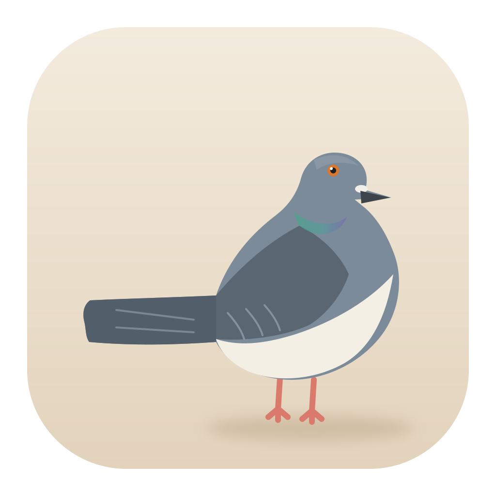
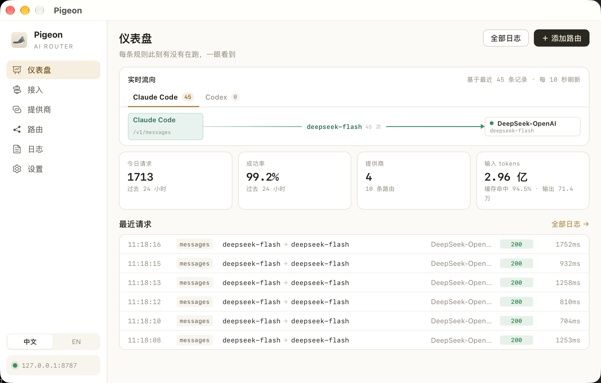

<div align="center">



# Pigeon

### 每个 Agent 熟悉的协议，任意模型。

**Claude Code 接 DeepSeek。Codex 接 Kimi。OpenAI 兼容客户端直通。**<br>
一个跑在本机的网关统一转发，改一次路由表，三端同时生效；<br>
关掉窗口它退进托盘，日志和用量随时能看。

[](https://github.com/charles6078/pigeon/releases/latest) [](https://github.com/charles6078/pigeon/releases)

[](https://github.com/charles6078/pigeon/releases) [](https://tauri.app) [](https://www.rust-lang.org) [](https://vuejs.org)<br>
    [](LICENSE)

[English](README.md) · **简体中文**

</div>

<br>

<div align="center">

</div>

<br>

## Pigeon 适合你吗？

每个 Agent 都把模型写在自己的文件里，格式、字段、地址各不相同；同一个 API Key 想在三个 Agent 里用，就得配三遍。Pigeon 把这些收进一个本地网关和一块桌面面板：

- **一个模型名，随便换上游。** 路由表里把 `claude-*` 指到 `deepseek/deepseek-v4-pro`，Claude Code 下一次请求就走 DeepSeek，不用改任何 Agent 配置。
- **一台机器上的 Key，所有 Agent 共用。** Claude Code、Codex、OpenCode / Cline / Cherry Studio 都连 `127.0.0.1:8787`，改提供商只改一处。
- **协议不对也能接。** Anthropic Messages、OpenAI Responses 进来，自动翻译成 OpenAI Chat 发给上游，流式和工具调用都保留。
- **只看 API Key，不碰订阅账号。** 不做 OAuth、不做账号池、不做配额调度，因此也不会有账号被风控的风险。
- **本机可观测。** 每次请求的模型、上游、状态、耗时、首 token 延迟、输入/输出 token（含缓存命中）都在日志里。

如果你只用一家官方客户端、一个官方套餐，那不需要它；当你有**多个 Agent、多个服务商，或者想让某个 Agent 用上别家的模型**时，它才划算。

## 快速开始

**1 · 安装。** 从 [Releases](https://github.com/charles6078/pigeon/releases/latest) 下载最新的 `.dmg`，打开后把 Pigeon 拖进「应用程序」。这个包是 ad-hoc 签名、未公证的，首次打开会被系统拦下 —— 右键点 App 选「打开」，或执行：

```sh
xattr -d com.apple.quarantine /Applications/Pigeon.app
```

只想跑服务、不要窗口：

```sh
/Applications/Pigeon.app/Contents/MacOS/pigeon --headless
```

默认监听 `127.0.0.1:8787`。

**2 · 添加提供商。** 打开 **提供商 → 新增**，选一个预设、粘贴 Key，点 **测试连接** 确认可达。

**3 · 写一条路由。** 在 **路由** 页把前门模型名指向上游，例如 `claude-opus-5-5 → anthropic/claude-opus-5-5`、`claude-* → deepseek/deepseek-v4-pro`。从上到下，首个命中生效。同一个 pattern 写多条规则即构成候选链：某个上游连不上或返回 401 / 403 / 404 / 429 / 5xx 时，按顺序换下一个。每条链是一张卡，卡底的 **＋ 添加兜底** 追加下一个候选。

**4 · 接入 Agent。** 在 **接入** 页选 Claude Code / Codex / OpenCode，一键写入它的配置文件；Pigeon 会先备份原文，随时可以一键还原。

也可以手动配：

```sh
# Claude Code
export ANTHROPIC_BASE_URL=http://127.0.0.1:8787
export ANTHROPIC_AUTH_TOKEN=pigeon      # 访问令牌留空时任意值即可

# OpenAI 兼容客户端
export OPENAI_BASE_URL=http://127.0.0.1:8787/v1
export OPENAI_API_KEY=pigeon
```

## 支持的接入方

| 接入方 | 前门协议 | 用法 |
| --- | --- | --- |
| **Claude Code** | Anthropic Messages | 指 `ANTHROPIC_BASE_URL`，接 Anthropic 或任意 OpenAI Chat 上游 |
| **Codex** | OpenAI Responses | 在 `~/.codex/config.toml` 指 `base_url` + `wire_api = "responses"` |
| **OpenCode** | OpenAI Chat | 接入页生成 `/v1` 配置片段，一键写入 |
| **Cline / Cherry Studio / 其他 OpenAI 兼容客户端** | OpenAI Chat | Base URL 填 `http://127.0.0.1:8787/v1` |
| **任何能设 base URL 的程序** | OpenAI Chat | 同上；模型名按路由表改写 |

## 它是怎么连起来的

```
Claude Code ─┐
Codex ───────┤   127.0.0.1:8787                 ┌─ Anthropic
OpenCode ────┼──▶ 路由匹配 ──▶ 直通 / 翻译 ──▶ ──┼─ OpenAI / DeepSeek / Kimi
Cline ───────┘         │                        ├─ GLM / 通义 / 硅基流动
                       └── 日志 · 用量 · 流式转发  └─ OpenRouter / Gemini / 自定义
```

网关同时说 OpenAI Chat、Anthropic Messages 和 OpenAI Responses 三种协议，并在需要时互相翻译——流式、工具调用、图片和错误都按目标协议重建。

## 功能

### 任意模型，任意 Agent

路由表用 `pattern → provider/model` 表达路由，支持精确名和 `*` 通配，以及实时试算命中结果。

同一个 pattern 重复出现即构成候选链：`deepseek-flash` 可以先走 DeepSeek，不行再换 WorkBuddy，再不行换腾讯，顺序由你排列。上游连不上、或返回 401 / 403 / 404 / 429 / 5xx 时自动换下一个；400 / 413 / 422 属于请求本身有问题，直接终止，不再换。

路由页把同一个 pattern 的规则归到一张卡里，并给出每个候选在最近请求日志里的实际表现：

| 列 | 含义 |
| --- | --- |
| 命中占比 | 该候选服务的请求 ÷ 命中这条链的请求 |
| 成功率 | 2xx ÷ 该候选服务的请求 |
| 平均耗时 | 端到端平均耗时 |

`GET /v1/models` 会把非通配路由暴露给 OpenCode 等客户端拉取。

### 协议翻译（核心）

| 前门（Agent 说的） | 上游 wire | 处理方式 |
| --- | --- | --- |
| Chat Completions | `openai-chat` | **字节直通**（含 SSE） |
| Anthropic Messages | `anthropic` | **字节直通** |
| Anthropic Messages | `openai-chat` | **翻译**：请求、流式事件、工具调用、图片、错误 |
| OpenAI Responses | `openai-chat` | **翻译**：请求、事件流、`function_call`、错误 |
| OpenAI Responses | Responses 上游 | 直通 |

原则是**同协议永不解析**：请求体流式收、响应逐块回写，只透传状态码与必要头部。跨协议才解析 JSON / SSE；SSE 解析器自带半块缓冲，任意 TCP 切分都能正确处理。首字节前失败可重试，首字节后绝不重试，错误以流内事件表达。

### 提供商

预设覆盖 **DeepSeek · Kimi · 智谱 GLM · OpenAI · Anthropic · 通义千问 · 硅基流动 · OpenRouter · Gemini · WorkBuddy · 自定义**。每个提供商可填多个模型、随时编辑、**一键测试连接**（返回状态码与延迟）。所有上游都只依赖 API Key。

### 接入页：写进去，也能还原

不用手抄配置：选一个 Agent，Pigeon 把 `base_url`、令牌和当前路由模型写进它自己的文件（`~/.claude/settings.json`、`~/.codex/config.toml`、`~/.config/opencode/opencode.json`），格式保持原生、注释和原有字段不动。写入前先备份，**还原**即恢复原文；解析不了的文件会拒绝修改，不会写坏。

### 日志与用量

- 实时日志列表：接入方、前门模型 → 上游模型、提供商、状态、耗时、首 token 延迟、token 用量
- 输入 token 区分**新算 / 缓存命中**；按天 JSONL 落盘，内存保留最近 1000 条
- 最近 24 小时统计：请求数、成功率、平均耗时、总 token
- 请求/响应体默认**不落盘**，设置页可显式打开并给出隐私提示

### 托盘与无窗口服务

关窗口只隐藏，代理继续运行；点菜单栏图标弹出快速面板。`--headless` 时同一二进制跳过 Tauri，纯 axum 服务运行，适合开机自启或放在服务器上。

### 中英切换

界面语言在侧栏底部的开关（以及托盘浮窗里）一键切换并记住选择，Element Plus 自带文案（分页、对话框）一并跟随。后端生成的提示——测试连接结果、接入写入与还原、配置校验错误、接口错误体——以及托盘右键菜单也按同一语言输出。`--headless` 没有界面，用 `PIGEON_LANG=en`（或 `zh`）指定。

### WorkBuddy 上游（可选，可整体摘除）

内置一个隔离的国际版 WorkBuddy 上游适配器：读取本机登录态（只读，也支持手动填 token）、按官方客户端形态构造请求头与 body、对 `11128 / 11140 / 11115 / 14003 / 14018` 等错误分类处理（其中 11128 会在发送前中和可疑的 system 开头）。它与其余代码只有一个接缝，删掉 `src-tauri/src/workbuddy/`、几处早返回和两个配置字段即可完全复原。

> 该上游自身声明可能限制非官方客户端，只建议接自己的单账号、低频使用。

## 命令行与配置

配置在 `~/.config/pigeon/config.json`（`PIGEON_CONFIG` 可覆盖），权限 `0600`，写入采用临时文件 + rename。修改即时热生效，只有监听地址变更需要重启服务。

```jsonc
{
  "server": { "host": "127.0.0.1", "port": 8787, "access_token": "" },
  "providers": [
    {
      "id": "deepseek",
      "name": "DeepSeek",
      "wire": "openai-chat",          // openai-chat | anthropic
      "base_url": "https://api.deepseek.com",
      "api_key": "sk-…",
      "models": ["deepseek-v4-pro", "deepseek-v4.1-flash"]
    }
  ],
  "routes": [
    { "pattern": "claude-opus-5-5", "target": "anthropic/claude-opus-5-5" },
    { "pattern": "claude-*",        "target": "deepseek/deepseek-v4-pro" },
    // 同一个 pattern 再写一次即为候补，上一条失败时按顺序尝试
    { "pattern": "deepseek-flash",  "target": "deepseek/deepseek-v4.1-flash" },
    { "pattern": "deepseek-flash",  "target": "workbuddy/hy3" }
  ],
  "options": { "reasoning": "drop", "log_retention_days": 7, "log_bodies": false }
}
```

接口一览：

| 方法 | 路径 | 说明 |
| --- | --- | --- |
| `POST` | `/v1/messages` | Claude Code；Anthropic 直通或翻译到 Chat |
| `POST` | `/v1/messages/count_tokens` | 输入 token 估算 |
| `POST` | `/v1/chat/completions`、`/chat/completions` | OpenAI Chat 直通，模型名按路由改写 |
| `POST` | `/v1/responses`、`/responses` | Codex；直通或翻译到 Chat |
| `GET` | `/v1/models`、`/v1/models/{id}` | 按路由表列出模型 |
| `GET` | `/` | 服务信息 |

`access_token` 非空时，所有接口校验 `Authorization`；留空则任何本机客户端都能连。

## 里程碑

| # | 内容 | 状态 |
| --- | --- | --- |
| M0 | 骨架：Tauri + Vue + 配置读写 + 空 axum 服务 | ✅ |
| M1 | Chat 直通 + Provider 页 + 测试连接 | ✅ |
| M2 | Anthropic → Chat 翻译（Claude Code） | ✅ |
| M3 | 日志、用量、Dashboard、路由测试器 | ✅ |
| M4 | `/v1/responses` → Chat（Codex） | ✅ |
| M5 | 打包：图标、dmg、托盘 | ✅ |
| — | 接入页：Claude Code / Codex / OpenCode 一键写入与还原 | ✅ |
| — | WorkBuddy 国际版上游（隔离、可摘除） | ✅ |
| — | 中英双语界面与后端提示 | ✅ |
| — | 候选链：一个匹配可挂多个上游，按顺序尝试 | ✅ |
| — | 路由页：一条链一张卡，带命中占比、成功率与耗时 | ✅ |

## 隐私与安全边界

- 默认只绑 `127.0.0.1`；改为其他地址时界面红字警告
- 不设置 CORS 头，浏览器页面默认无法调用
- 配置文件 `0600`，密钥明文存储（先用最低复杂度）
- 日志默认不记录请求/响应体
- **不收集任何遥测**，不联网上报
- 不做订阅 OAuth、账号池、配额调度，不触碰厂商账号条款
- WorkBuddy 接入只**读**本机登录文件，写只写 Pigeon 自己的目录

## 许可证

Apache License 2.0 — 见 [LICENSE](LICENSE) 与 [NOTICE](NOTICE)。你可以自由使用、修改、再分发 Pigeon，包括商用和集成进闭源产品，只需保留版权与许可声明。该协议同时提供明确的专利授权，但不授予 "Pigeon" 名称和图标的使用权。

Pigeon 打包了按各自许可证分发的第三方 crate 与 npm 包，完整清单与全部许可证全文见 [THIRD-PARTY-NOTICES.md](THIRD-PARTY-NOTICES.md)，该文件也会随安装包一起分发。

## 商标

"Pigeon" 名称与鸽子图标归项目作者所有。欢迎 fork，但修改后的分发版本请使用不同的名称和图标，这是 Apache-2.0 第 6 条的要求。
