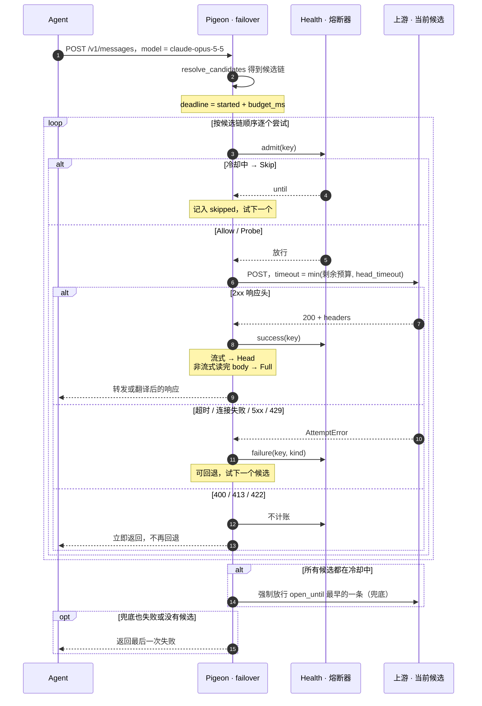
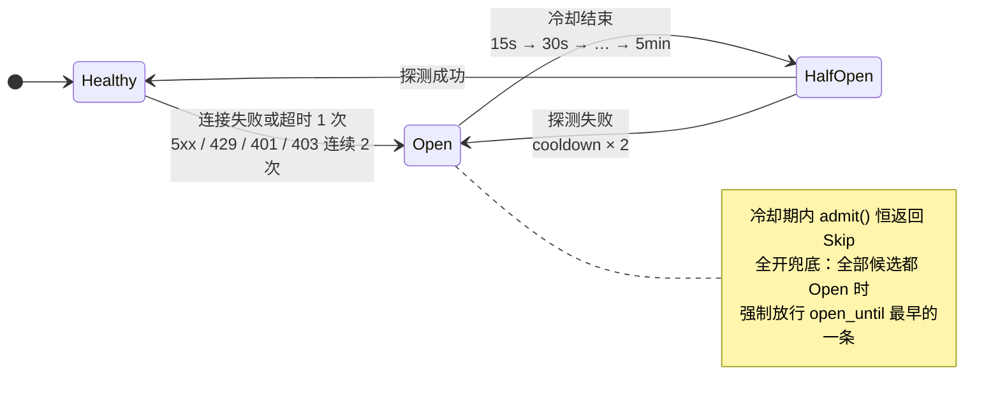
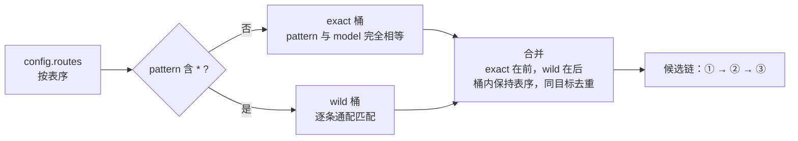

# 路由 failover 改造方案（TDD）

> 状态：已实现 · 2026-11-22
> 范围：`src-tauri/src/route.rs`、`src-tauri/src/server/mod.rs`、新增 `src-tauri/src/health.rs`、`config.rs`、`usage.rs`、`lib.rs`、`commands.rs`、前端 `types.ts` / `SettingsPage.vue`
> 不引入新依赖

---

## 1. 现状判定

路由表顺序被当作优先级，这一点保留。问题在实现：

| # | 问题 | 证据 | 后果 |
|---|---|---|---|
| 1 | 没有跨请求失败记忆 | `route.rs:15` 每次全表重算；三个 handler 各自 `for` 循环 | 挂掉的头部上游每个请求都先撞一次，连接失败最多耗 10s |
| 2 | 只有 connect_timeout，没有响应头超时 | `lib.rs:44-47` | 上游接了 TCP 不回包 → 请求挂到客户端超时 |
| 3 | 非流式读 body 失败被吞 | `server/mod.rs:217`、`600`、`1127` 的 `bytes().await.unwrap_or_default()` | 回给客户端 **200 + 空 body**，且不回退 |
| 4 | 同一段回退逻辑复制三份 | `server/mod.rs:173-203`、`544-574`、`1065-1095` | 改一处漏两处；responses 路径的错误分类没人维护 |
| 5 | 通配规则会压住精确规则 | `route.rs:20` 纯按行序 | `claude-*` 写在表头时，下面所有精确规则静默降级为兜底 |
| 6 | 日志只留最后一次尝试 | `server/mod.rs:176-177` 循环覆盖 `model_out/provider` | 看不出请求实际试过几条、跳过了谁 |

---

## 2. 设计总览

三张图对应三个不同层面：**请求内**怎么走候选链（时序图）、**请求间**熔断状态怎么迁移（状态图）、**候选链**怎么排出来（流程图）。

### 2.1 请求内：候选链如何被逐个尝试



对应实现：`failover()` + `try_one()`（§5.3），准入判断在 `Health::admit()`（§3）。

### 2.2 请求间：熔断状态机



阈值与冷却：

| 失败类型 | 打开阈值 | 首次冷却 |
|---|---|---|
| 连接失败、超时 | 1 次 | 15s |
| 5xx / 429 / 401 / 403 | 连续 2 次 | 15s |
| 400 / 413 / 422 | 不计入 | — |
| 501（本地能力不支持） | 不计入 | — |

`429` 带 `Retry-After` 时用它作为 `open_until`（上限 5min）。

### 2.3 候选链如何排序



### 2.4 关键边界

- **熔断状态跨请求，不跨配置**：`save_config` 成功后整体清空。
- **只在"拿到响应头"之前回退**：流式一旦开始吐字节就不回退，也不释放候选。
- **全开兜底**：所有候选都在 Open 时不能直接失败，强制放行最早到期的一条。
- **配置默认值下行为与现在一致**，唯一例外是 §7 的排序修正。

---

## 3. 新增 `src-tauri/src/health.rs`

```rust
use axum::http::StatusCode;
use std::collections::HashMap;
use std::sync::RwLock;
use std::time::{Duration, Instant};

/// 半开窗口内两次探测的最小间隔，防止探测请求同时打满。
const PROBE_INTERVAL: Duration = Duration::from_secs(10);
const BASE_COOLDOWN: Duration = Duration::from_secs(15);
const MAX_COOLDOWN: Duration = Duration::from_secs(300);

/// 一条上游链路的健康键：(provider, 上游模型)。
/// 换模型通常意味着换容量/换配额，按模型分桶比按 provider 分桶更准。
#[derive(Clone, PartialEq, Eq, Hash)]
pub struct Key {
    pub provider: String,
    pub model: String,
}

impl Key {
    pub fn new(provider: &str, model: &str) -> Self {
        Self { provider: provider.to_string(), model: model.to_string() }
    }
    /// 日志展示用：`deepseek/deepseek-v4-pro`
    pub fn joined(&self) -> String {
        format!("{}/{}", self.provider, self.model)
    }
}

/// 这次失败是否值得记到上游健康账上。
#[derive(Debug, Clone, Copy, PartialEq, Eq)]
pub enum FailureKind {
    Connect,
    Timeout,
    /// 上游返回了非 2xx（status 见 AttemptError.status）
    Http,
    /// 本地能力不支持（如 Chat 前门接 Anthropic 上游的 501）：不怪上游
    Capability,
    /// 请求体本身有问题（400/413/422）：换谁都一样，不算上游
    Request,
}

impl FailureKind {
    /// 是否继续尝试下一个候选。
    pub fn should_failover(self, status: StatusCode) -> bool {
        match self {
            FailureKind::Request => false,
            _ => true,
        }
    }
    /// 是否计入熔断。
    fn counts(self) -> bool {
        matches!(self, FailureKind::Connect | FailureKind::Timeout | FailureKind::Http)
    }
    fn opens_immediately(self) -> bool {
        matches!(self, FailureKind::Connect | FailureKind::Timeout)
    }
    pub fn as_str(self) -> &'static str {
        match self {
            FailureKind::Connect => "connect",
            FailureKind::Timeout => "timeout",
            FailureKind::Http => "http",
            FailureKind::Capability => "capability",
            FailureKind::Request => "request",
        }
    }
}

pub enum Admission {
    Allow,
    /// 冷却已过，这次是探测
    Probe,
    /// 冷却中，带上到期时间供全开兜底比较
    Skip { until: Instant },
}

#[derive(Default)]
struct Entry {
    consecutive: u32,
    open_until: Option<Instant>,
    cooldown: Duration,
    next_probe_at: Option<Instant>,
}

pub struct Health {
    enabled: std::sync::atomic::AtomicBool,
    entries: RwLock<HashMap<Key, Entry>>,
}

impl Health {
    pub fn new(enabled: bool) -> Self {
        Self {
            enabled: std::sync::atomic::AtomicBool::new(enabled),
            entries: RwLock::new(HashMap::new()),
        }
    }

    pub fn set_enabled(&self, enabled: bool) {
        self.enabled.store(enabled, std::sync::atomic::Ordering::Relaxed);
        if !enabled {
            self.invalidate();
        }
    }

    /// 配置保存后调用：旧的上游可能换了地址或 key，健康结论立即作废。
    pub fn invalidate(&self) {
        self.entries.write().unwrap_or_else(|err| err.into_inner()).clear();
    }

    /// 只做准入判断，不改状态里的 consecutive。
    /// 探测槽位用 next_probe_at 占位而不是 probing 布尔：请求被取消也不会卡死。
    pub fn admit(&self, key: &Key) -> Admission {
        if !self.enabled.load(std::sync::atomic::Ordering::Relaxed) {
            return Admission::Allow;
        }
        let mut entries = self.entries.write().unwrap_or_else(|err| err.into_inner());
        let entry = entries.entry(key.clone()).or_default();
        let now = Instant::now();
        match entry.open_until {
            Some(until) if until > now => Admission::Skip { until },
            Some(_) => {
                let slot = entry.next_probe_at.unwrap_or(now);
                if now >= slot {
                    entry.next_probe_at = Some(now + PROBE_INTERVAL);
                    Admission::Probe
                } else {
                    Admission::Skip { until: slot }
                }
            }
            None => Admission::Allow,
        }
    }

    pub fn success(&self, key: &Key) {
        let mut entries = self.entries.write().unwrap_or_else(|err| err.into_inner());
        if let Some(entry) = entries.get_mut(key) {
            entry.consecutive = 0;
            entry.open_until = None;
            entry.cooldown = Duration::ZERO;
            entry.next_probe_at = None;
        }
    }

    pub fn failure(&self, key: &Key, kind: FailureKind, status: StatusCode, retry_after: Option<Duration>) {
        if !self.enabled.load(std::sync::atomic::Ordering::Relaxed) || !kind.counts() {
            return;
        }
        let mut entries = self.entries.write().unwrap_or_else(|err| err.into_inner());
        let entry = entries.entry(key.clone()).or_default();
        entry.consecutive += 1;

        let threshold = if kind.opens_immediately() { 1 } else { 2 };
        if entry.consecutive < threshold {
            return;
        }

        let base = if entry.cooldown.is_zero() { BASE_COOLDOWN } else { entry.cooldown * 2 };
        let cooldown = retry_after.unwrap_or(base).min(MAX_COOLDOWN);
        entry.cooldown = cooldown;
        entry.open_until = Some(Instant::now() + cooldown);
        entry.next_probe_at = None;
    }

    /// 前端状态点用；不参与路由决策。
    pub fn snapshot(&self) -> Vec<HealthSnapshot> { /* provider, model, state, retry_in_ms */ }
}
```

**实现要点**

1. `admit` 的探测槽位靠 `next_probe_at` 时间戳占位，**不需要释放**，所以请求被 `timeout` 取消也不会永久占槽。
2. `failure` 里的 `retry_after` 只对 429 生效；其余类型传 `None`。
3. 所有方法持锁不跨 `await`，可以放心从 async 代码里调用。
4. 默认 `enabled = true`；关掉时 `admit` 恒 `Allow`、`failure` 直接返回，行为与现状完全一致。

---

## 4. 失败分类下沉到 attempt

把 `type Attempt = Result<reqwest::Response, (StatusCode, String)>` 换成带类型的错误，`should_failover` 搬到 `FailureKind`（`server/mod.rs:815` 删除）。

```rust
pub(crate) struct AttemptError {
    pub status: StatusCode,
    pub message: String,
    pub kind: FailureKind,
    /// 429 可能带 Retry-After
    pub retry_after: Option<Duration>,
}

impl AttemptError {
    fn request(status: StatusCode, message: String) -> Self { /* kind: Request */ }
    fn capability(message: String) -> Self { /* 501 + Capability */ }
    fn connect(err: String) -> Self { /* 502 + Connect */ }
    fn timeout(message: String) -> Self { /* 504 + Timeout */ }
    fn http(status: StatusCode, message: String, retry_after: Option<Duration>) -> Self { /* kind: Http */ }
}
```

`post_with_404_fallback`（`server/mod.rs:1338`）：

- `request.send()` 的 `Err` → `AttemptError::connect(...)`
- 全部端点 404 → `AttemptError::http(404, last_body, None)`
- 其余非 2xx → `AttemptError::http(status, text, retry_after_of(&headers))`

新增小工具：

```rust
fn retry_after_of(headers: &HeaderMap) -> Option<Duration> {
    let secs = headers.get("retry-after")?.to_str().ok()?.trim().parse::<u64>().ok()?;
    Some(Duration::from_secs(secs))
}
```

各 `attempt_*` 内部的序列化失败保持 `AttemptError::request`（本地错误，不回退）。

---

## 5. 统一回退循环

### 5.1 出口形态

```rust
/// 上游连接：流式拿到响应头就算成功，非流式必须整包读完。
pub(crate) enum Upstream {
    Head(reqwest::Response),
    Full(reqwest::Response, Bytes),
}

pub(crate) struct Selected<'a> {
    pub target: &'a route::Resolved<'a>,
    pub upstream: Upstream,
}
```

### 5.2 一个 `attempt` 覆盖三个前门

```rust
#[derive(Clone, Copy, PartialEq, Eq)]
pub(crate) enum Front { Chat, Messages, Responses }

async fn attempt(
    state: &AppState,
    front: Front,
    target: &route::Resolved<'_>,
    value: &Value,
    meta: &RequestMeta<'_>,
) -> Result<Upstream, AttemptError>
```

`RequestMeta` 只带 `stream: bool` 和 `accept: Option<&str>`（当前 `attempt_messages` 会透传客户端的 `accept`）。内部按 `front` 分派到现有三套构造逻辑，非流式分支在读完 body 后才返回：

```rust
// 三处共用：拿到 response 后
if meta.stream {
    return Ok(Upstream::Head(response));
}
let bytes = response.bytes().await
    .map_err(|err| AttemptError::http(StatusCode::BAD_GATEWAY, format!("读取上游响应失败：{err}"), None))?;
Ok(Upstream::Full(response, bytes))
```

> 注意：`Full` 里同时保留 `response` 是因为后续要用它的 `content-type` 头。

### 5.3 `failover`

```rust
async fn failover<'a>(
    state: &AppState,
    options: &config::FailoverOptions,
    front: Front,
    targets: &'a [route::Resolved<'a>],
    value: &Value,
    meta: &RequestMeta<'_>,
    log: &mut LogContext,
    started: Instant,
) -> Result<Selected<'a>, AttemptError> {
    let deadline = started + Duration::from_millis(options.budget_ms);
    let per_attempt = if meta.stream { options.head_timeout_ms } else { options.request_timeout_ms };
    let mut skipped: Vec<(usize, Instant)> = Vec::new();
    let mut last: Option<AttemptError> = None;

    for (index, target) in targets.iter().enumerate() {
        let key = Key::new(&target.provider.id, &target.upstream_model);
        if let Admission::Skip { until } = state.health.admit(&key) {
            skipped.push((index, until));
            continue;
        }
        match try_one(state, front, target, value, meta, log, per_attempt, deadline).await {
            Ok(selected) => {
                log.record_skipped(targets, &skipped);
                return Ok(selected);
            }
            Err(err) => {
                log.record_failure(target, &err);
                if !err.kind.should_failover(err.status) {
                    return Err(err);
                }
                last = Some(err);
            }
        }
    }

    // 全开兜底：挑最早到期的一条强制探测一次，不能让请求无谓失败
    if let Some((index, _)) = skipped.iter().min_by_key(|(_, until)| *until) {
        if let Ok(selected) =
            try_one(state, front, &targets[*index], value, meta, log, per_attempt, deadline).await
        {
            log.record_skipped(targets, &skipped);
            return Ok(selected);
        }
    }
    log.record_skipped(targets, &skipped);

    Err(last.unwrap_or_else(|| AttemptError::http(
        StatusCode::BAD_GATEWAY,
        tr!("所有候选上游都不可用", "Every candidate upstream failed").to_string(),
        None,
    )))
}
```

`try_one` 负责"超时 + 尝试 + 记账"，把上面循环的样板收在一处：

```rust
async fn try_one<'a>(
    state: &AppState,
    front: Front,
    target: &'a route::Resolved<'a>,
    value: &Value,
    meta: &RequestMeta<'_>,
    log: &mut LogContext,
    per_attempt: u64,
    deadline: Instant,
) -> Result<Selected<'a>, AttemptError> {
    let key = Key::new(&target.provider.id, &target.upstream_model);
    let remaining = deadline.saturating_duration_since(Instant::now());
    let limit = Duration::from_millis(per_attempt).min(remaining);
    if limit.is_zero() {
        return Err(AttemptError::timeout(tr!("上游总预算已耗尽", "Upstream budget exhausted").to_string()));
    }

    log.model_out = target.upstream_model.clone();
    log.provider = target.provider.id.clone();

    match tokio::time::timeout(limit, attempt(state, front, target, value, meta)).await {
        Ok(Ok(upstream)) => {
            state.health.success(&key);
            Ok(Selected { target, upstream })
        }
        Ok(Err(err)) => {
            state.health.failure(&key, err.kind, err.status, err.retry_after);
            Err(err)
        }
        Err(_) => {
            let err = AttemptError::timeout(tr!(
                format!("上游 {} 在 {}ms 内没有响应头", key.joined(), limit.as_millis()),
                format!("Upstream {} sent no response head within {}ms", key.joined(), limit.as_millis())
            ).to_string());
            state.health.failure(&key, err.kind, err.status, None);
            Err(err)
        }
    }
}
```

> 超时包在整次 `attempt` 外层是安全的：此刻还没有向客户端写出任何字节；`reqwest` 的响应流在 drop 时自动断开，不会泄漏连接。

### 5.4 三个 handler 的收敛

以 `/v1/messages` 为例（`server/mod.rs:533-574` 整段替换）：

```rust
let targets = match route::resolve_candidates(&config, &front_model) {
    Ok(targets) => targets,
    Err(err) => { /* 保持现状 */ }
};
let meta = RequestMeta { stream, accept: headers.get(header::ACCEPT).and_then(|v| v.to_str().ok()) };
let selected = match failover(&state, &config.options.failover, Front::Messages, &targets, &value, &meta, &mut log, started).await {
    Ok(selected) => selected,
    Err(err) => {
        log.finish(err.status.as_u16(), None, Some(err.message.clone()), None, None);
        return anthropic_error(err.status, &err.message);
    }
};
let Selected { target, upstream } = selected;
```

`chat`、`responses` 同构。响应阶段把现有分支从 `reqwest::Response` 改成 `Upstream`：

| 原有分支 | 改造 |
|---|---|
| `relay_response_with_usage(upstream, ..)` | `Upstream::Head(r) => relay_response_with_usage(r, ..)` |
| `upstream.json().await` | `Upstream::Full(_, bytes) => serde_json::from_slice(&bytes)` |
| `upstream.bytes().await.unwrap_or_default()` | 删除；直接用 `Full` 里的 `bytes` |
| `workbuddy::respond_*(upstream, ..)` | 传 `Head` 里的 response（WorkBuddy 只走流式语义，非流式时也按 Head 处理，见 §10 备注） |

---

## 6. 超时配置

`config.rs`：

```rust
#[derive(Debug, Clone, Serialize, Deserialize)]
pub struct FailoverOptions {
    /// 关闭后回到"每次都从第一条试起"的旧行为，用于回滚
    #[serde(default = "yes")]
    pub enabled: bool,
    /// 流式：等响应头
    #[serde(default = "head_timeout")]
    pub head_timeout_ms: u64,
    /// 非流式：响应头 + body
    #[serde(default = "request_timeout")]
    pub request_timeout_ms: u64,
    /// 单请求所有候选的总预算
    #[serde(default = "budget")]
    pub budget_ms: u64,
}
```

默认值 `enabled = true`、`head = 20_000`、`request = 120_000`、`budget = 90_000`；`Options::default()` 里补 `failover: FailoverOptions::default()`。

---

## 7. `route.rs`：精确优先

`resolve_candidates`（`route.rs:15`）改为两个桶，桶内仍严格按表序：

```rust
let mut exact: Vec<Resolved<'a>> = Vec::new();
let mut wild: Vec<Resolved<'a>> = Vec::new();

for rule in &config.routes {
    let is_wild = rule.pattern.contains('*');
    if is_wild { if !matches(&rule.pattern, model) { continue; } }
    else if rule.pattern != model { continue; }
    // ...原有 target 解析与 provider 查找...
    let bucket = if is_wild { &mut wild } else { &mut exact };
    if bucket.iter().any(|item| same_target(item, &resolved)) { continue; }
    bucket.push(resolved);
}
exact.append(&mut wild);
```

行为变化：**通配规则不再能插队到精确规则前面**。同 specificity 内的顺序不变，现有 6 个 route 测试无需修改。

如果要"通配也能按表序抢先"，只需在 §7 前加开关；默认我们按上面的语义走。

---

## 8. 日志 schema

`usage.rs` 的 `LogEntry` 追加两段（`#[serde(default)]`，旧行可解析）：

```rust
/// 本请求实际尝试过的上游及失败原因
#[serde(default, skip_serializing_if = "Vec::is_empty")]
pub attempts: Vec<AttemptRecord>,

/// 因熔断被跳过的上游
#[serde(default, skip_serializing_if = "Vec::is_empty")]
pub skipped: Vec<String>,
```

```rust
pub struct AttemptRecord {
    pub provider: String,
    pub model: String,
    /// 成功那次为 None
    pub status: Option<u16>,
    /// connect / timeout / http / capability / request
    pub kind: Option<String>,
}
```

`LogContext` 增加 `attempts/skipped` 累积字段，`log.finish*` 时带出。同时修掉 `provider/model_out` 被循环覆盖的问题：最终值以命中的候选为准，前面失败的进 `attempts`。

---

## 9. 接线

| 位置 | 改动 |
|---|---|
| `lib.rs:41-65` | `Core` 增加 `health: Arc<Health>`，`new()` 里按配置构造 |
| `lib.rs:68-74` | `app_state()` 带上 `health` |
| `commands.rs:85` | `save_config` 写入配置后调用 `core.health.set_enabled(config.options.failover.enabled)` + `invalidate()` |
| `commands.rs:643`、`server/mod.rs:1698`、`1852` | 测试用 `AppState` 补字段 |
| `lib.rs` 注册命令 | 新增 `health_snapshot()`（可选，P2） |

`AppState`：

```rust
pub struct AppState {
    pub config: Arc<RwLock<Config>>,
    pub client: reqwest::Client,
    pub logger: Arc<crate::usage::Logger>,
    pub health: Arc<crate::health::Health>,
}
```

---

## 10. 前端

1. `src/types.ts` 的 `Options` 增加 `failover: { enabled, head_timeout_ms, request_timeout_ms, budget_ms }`。
2. **必修**：`SettingsPage.vue:71-75` 现在重建 `options`，会把未展示的字段丢掉：

```diff
- options: {
-   reasoning: ...,
-   log_retention_days: ...,
-   log_bodies: ...,
- },
+ options: {
+   ...props.config.options,
+   reasoning: ...,
+   log_retention_days: ...,
+   log_bodies: ...,
+ },
```

3. **路由列表显示熔断状态**（`RoutesPage.vue`）：见 §10.1，这是状态的主要展示位置。
4. （可选）提供商卡片加状态点，数据同源，见 §10.2。

> 备注：WorkBuddy 上游只有流式语义，`meta.stream == false` 时仍按 `Head` 交给 `workbuddy::respond_*`，不做整包读取 —— 与现状一致。

### 10.1 路由列表里的状态列

**要区分两种“状态”，不能混在一列**

| 指标 | 来源 | 时间尺度 | 现有位置 |
|---|---|---|---|
| 成功率 | 日志文件（最近 N 次请求） | 历史，分钟~天 | `rw-ok` 列（`RoutesPage.vue:374`） |
| 熔断状态 | 内存 `Health` | 当下，秒级 | 新增 `状态` 列 |

两者经常不一致：成功率 100% 的候选可能刚刚连不上，正处于 15s 冷却。挤在一列会让用户看到“100% 但不可用”，所以新增一列。

**列值与配色**

| 值 | 条件 | 样式 |
|---|---|---|
| `正常` | `Healthy`，且有过流量 | 灰绿点 |
| `冷却 12s` | `Open`，倒计时到 `open_until` | 琥珀点 + 倒数 |
| `探测中` | `HalfOpen`，探测槽已占 | 蓝点 |
| `—` | 无记录（从未失败）或 `failover.enabled=false` | 灰点 |

**位置**：插在“匹配 / 上游”之后、“命中占比”之前。`RoutesPage.vue:464` 的 grid 加一列 66px，`<=1240px` 断点下隐藏（与现有的次数列一致）。

```diff
- grid-template-columns: 24px minmax(0, 1fr) 62px 74px 68px 70px 132px;
+ grid-template-columns: 24px minmax(0, 1fr) 64px 62px 74px 68px 70px 132px;
```

行模板 `.rw-cand` 里加：

```vue
<div class="rw-state" :class="stateAt(index).cls" :title="stateAt(index).title">
  <span class="rw-dot" />
  <span>{{ stateAt(index).label }}</span>
</div>
```

**数据通路**

新增命令（`commands.rs`）：

```rust
#[tauri::command]
pub async fn health_snapshot(core: State<'_, Arc<Core>>) -> Result<Vec<HealthSnapshot>, String> {
    Ok(core.health.snapshot())
}
```

```rust
#[derive(Serialize)]
pub struct HealthSnapshot {
    pub provider: String,
    pub model: String,
    /// healthy / open / half_open
    pub state: String,
    /// open 时距离可再尝试的毫秒数，供前端本地倒计时
    pub retry_in_ms: Option<u64>,
}
```

前端（`api.ts` 加 `healthSnapshot()`）：

- 与现有的 `loadLogs()` 共用 15s 轮询不合适——熔断是秒级变化。改为**独立 5s 轮询** + 收到 `retry_in_ms` 后本地 1s 递减，不额外发请求。
- 页面失焦/切走时暂停轮询（`document.visibilityState`），避免后台空转。
- 按 `(provider, model)` 建 Map，行内用 `config.routes[index].target.split('/')` 查表。

**细节**

- 键是 `(provider.id, upstream_model)`，与 §3 一致；同一 provider 下不同模型的状态互不影响，这正是路由列表需要展示的粒度。
- 冷却中的候选**不必置灰整个候选链**——它是兜底的下一条，用户要能看到“主用不行了，正在用兜底”，这恰好是链视图的价值。只在行内标注即可。
- `failover.enabled=false` 时整列显示 `—`，或直接不渲染该列（推荐后者，避免一列全是横杠）。

### 10.2 提供商卡片（可选，后置）

同一份 `health_snapshot()`，在 `ProvidersPage.vue` 的卡片上按 provider 汇总：任一模型 `open` 即显示琥珀点。它的价值低于路由列表——用户真正关心的是“这条路由现在打不打得通”，而不是“这个 provider 有没有某个模型在冷却”。建议等路由列表稳定后再做。

---

## 11. 测试

`server/mod.rs` 测试模块的 `spawn_fake_upstream` 拆成可配置版本：

```rust
struct FakeUpstream {
    addr: SocketAddr,
    hits: Arc<AtomicUsize>,
}

enum FakeMode {
    Ok,                      // 现有 SSE 行为
    Status(u16),             // 直接返回错误码
    HeadThenClose,           // 返回 200 头后断开，模拟读 body 失败
    NeverRespond,            // 收下连接不回包
}
async fn spawn_fake(mode: FakeMode) -> FakeUpstream
```

| 文件 | 用例 |
|---|---|
| `health.rs` | Connect 1 次即 Open；5xx 需 2 次；冷却期 `Skip`；半开只放 1 个；`invalidate` 后立即 `Allow`；400 不计入；429 + Retry-After 生效；`enabled=false` 恒 Allow |
| `route.rs` | 通配写在精确之前时仍精确先试；同 pattern 多规则保序；去重；现有 6 个测试不改 |
| `server` | ① 首选 500 → 次选成功，`hits` 证明第二家被调用；② 冷却期内第二次请求 **不再打** 首选（`hits` 不增）；③ 保存配置后首选恢复尝试；④ `HeadThenClose` + 非流式 → 回退到次选，不返回 200 空 body；⑤ `NeverRespond` → 20s 前返回 504 并回退（用 `head_timeout_ms: 100` 跑）；⑥ `failover.enabled=false` 时行为与旧版一致 |

---

## 12. 提交拆分与回滚

| # | 提交 | 行为变更 | 依赖 |
|---|---|---|---|
| 1 | `health.rs` + `AttemptError`/`FailureKind` + `failover()` 抽取，熔断恒 Allow | 无 | — |
| 2 | 接上熔断 + 全开兜底 + `invalidate` | 有（隐藏失败请求） | 1 |
| 3 | 响应头超时 + 总预算 | 有（超时回退） | 1 |
| 4 | 非流式整包语义 | 修 bug | 1 |
| 5 | 精确优先排序 | 有（通配不再插队） | — |
| 6 | 日志 schema + 前端 spread 修复 | 无 | 4 |
| 7 | `health_snapshot()` + 路由列表状态列 | 无 | 2 |

回滚：`options.failover.enabled = false` 退回旧的重试语义；超时与整包语义仍生效，需要全退则回滚版本。

---

## 13. 已确认的决策

1. **精确优先（§7）**：采用精确优先——exact 桶在前、wild 桶在后，桶内保持表序。
2. **熔断默认开启**：`options.failover.enabled` 默认 `true`；设置页可关闭，关闭后回到逐条尝试的旧语义。
3. **状态列位置（§10.1）**：路由列表新增独立「状态」列。

### 实现与本文的差异

- 后端 `Health::snapshot()` 只返回「正在失败或冷却」的条目，因此前端把**没有条目**的候选显示为「正常」，而不是设计稿里的 `—`：正常候选占多数，一列横杠反而更难读。
- `Health::failure` 不再接收 `Status`，只接收 `FailureKind` 与 `Retry-After`；400/413/422 在 `AttemptError::http` 构造时就归为 `Request`。
